# 面试题匣 · 本地优先面试题库

[](https://github.com/zhangfengyao01/interview-box/actions/workflows/ci.yml)
[](https://zhangfengyao01.github.io/interview-box/)


按 `面试题匣prd.md` 实现的面试题知识库：**图片 → OCR → 拆题 → 校对 → 入库 → 复习**，
数据全部存在本机，无账号体系，断网可用。UI 与设计稿
「面试题库智能学习应用界面展示」逐屏对齐。

**技术栈**：uni-app CLI（Vue3 + TypeScript + Vite）· Pinia · SQLite（`plus.sqlite`）· UTS OCR 插件

> **在线预览**：<https://zhangfengyao01.github.io/interview-box/>（push 到 main 自动发布）
>
> 这是 **H5 版**：数据库走 storage 快照、没有本地 OCR、不能拍照读图 —— 都是平台能力边界，
> 不是坏了。要在真机上体验 SQLite 与 OCR，得按[第五节](#五平台差异能力边界不是-bug)打包 APP。
> 在线版里的数据存在你浏览器的 localStorage，清一下缓存就是初始状态。

---

## 界面一览

下面每一张都是**真实渲染的截图**，不是效果图：`npm run build:h5` 出包 → 起静态服务 →
用固定 390px 宽的 iframe 承载页面 → 2 倍图截图（为什么必须走 iframe 见 [6.2](#62-截图为什么必须走-iframe)）。
源码在 `preview/screens.sh`，随时可以自己重跑一遍。

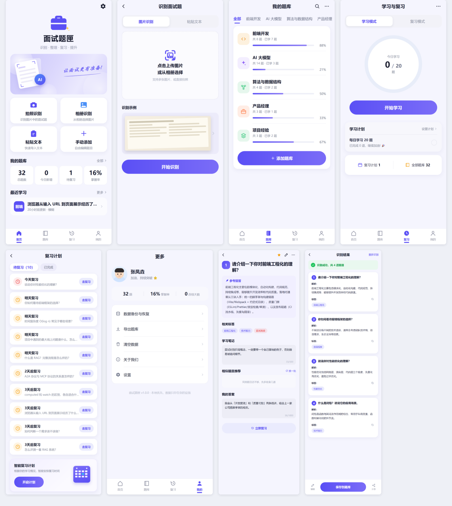

<sub>↑ 设计稿指定的 8 屏（<code>01</code>–<code>08</code>）。</sub>

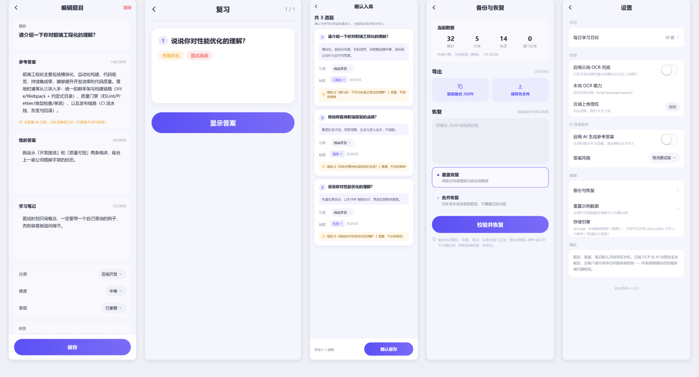

<sub>↑ 设计稿没画、但内部要验收的 5 个二级页（<code>09</code>–<code>13</code>）：编辑题目、复习会话、确认入库、备份恢复、设置。</sub>

> 截图为演示库初始状态：共 18 题、今天还没学，所以复习环是 `0 / 20`。
> 这些数字全部来自真实统计，没有写死（见 [已知限制](#七已知限制如实列出) 第 5 条）。

<details>
<summary>13 屏单张（点击展开，可按编号对照上面两张合集）</summary>

<br>

<table>
  <tr>
    <td align="center" valign="top">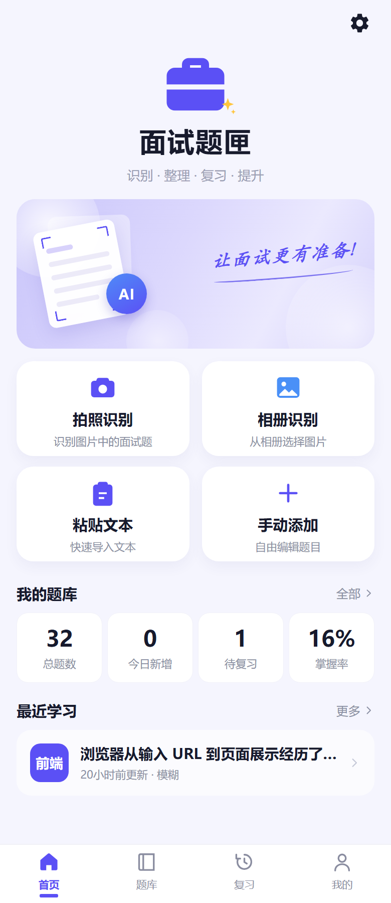<br><sub><b>01</b> 首页 · 四入口 + 真实统计</sub></td>
    <td align="center" valign="top">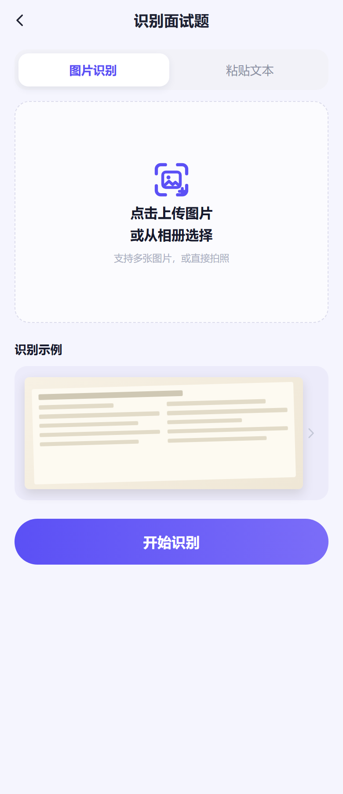<br><sub><b>02</b> 识别 · 图片 / 粘贴文本</sub></td>
    <td align="center" valign="top">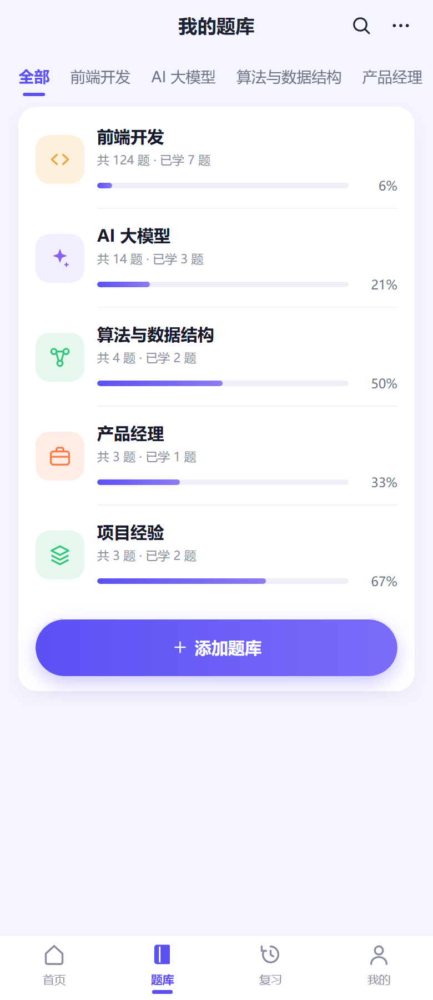<br><sub><b>03</b> 题库 · 一个白容器四行</sub></td>
    <td align="center" valign="top">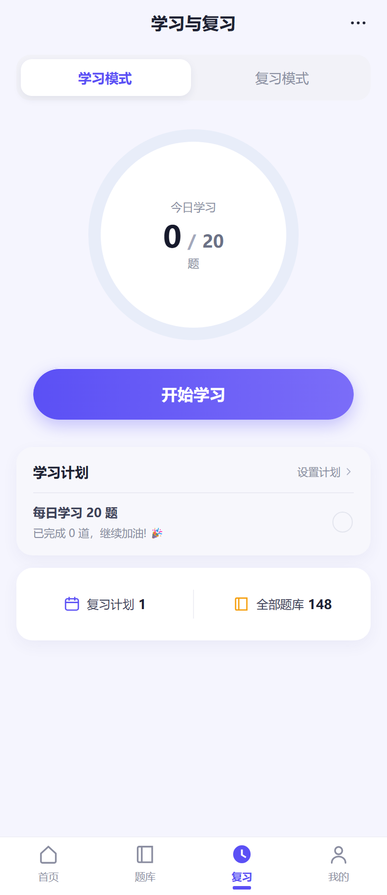<br><sub><b>04</b> 复习 · 今日进度环</sub></td>
  </tr>
  <tr>
    <td align="center" valign="top">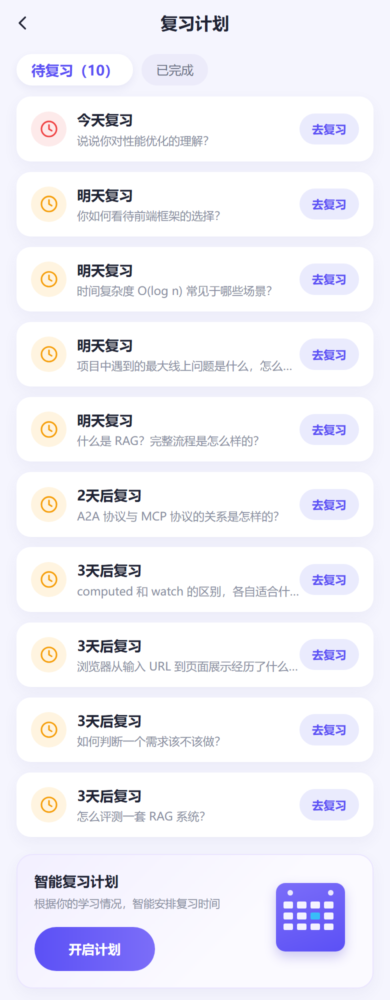<br><sub><b>05</b> 计划 · 1/3/7 天到期表</sub></td>
    <td align="center" valign="top">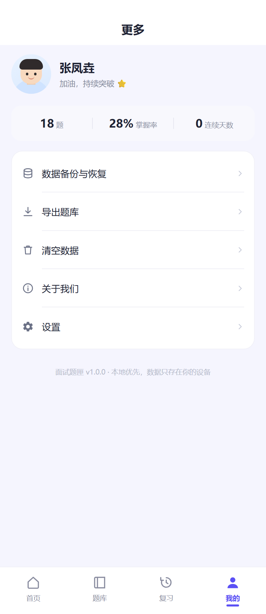<br><sub><b>06</b> 更多 · 备份 / 清空 / 设置</sub></td>
    <td align="center" valign="top">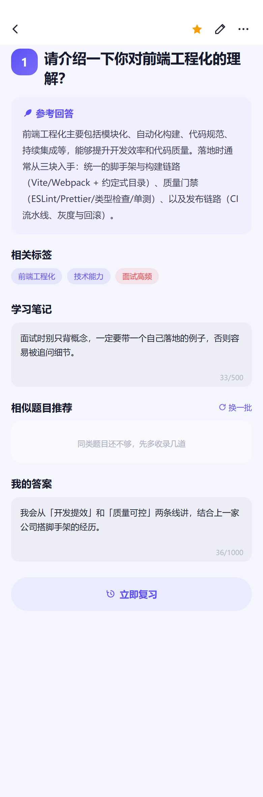<br><sub><b>07</b> 详情 · 参考回答 + 笔记</sub></td>
    <td align="center" valign="top">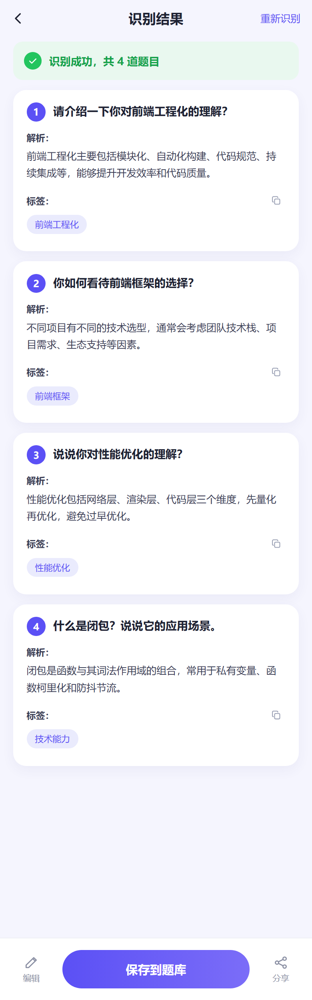<br><sub><b>08</b> 识别结果 · 按编号拆题</sub></td>
  </tr>
  <tr>
    <td align="center" valign="top">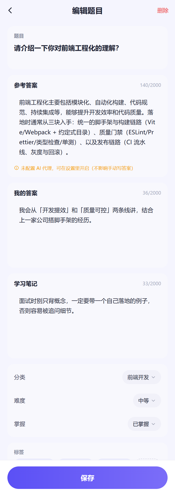<br><sub><b>09</b> 编辑题目 · AI 草稿只作草稿</sub></td>
    <td align="center" valign="top">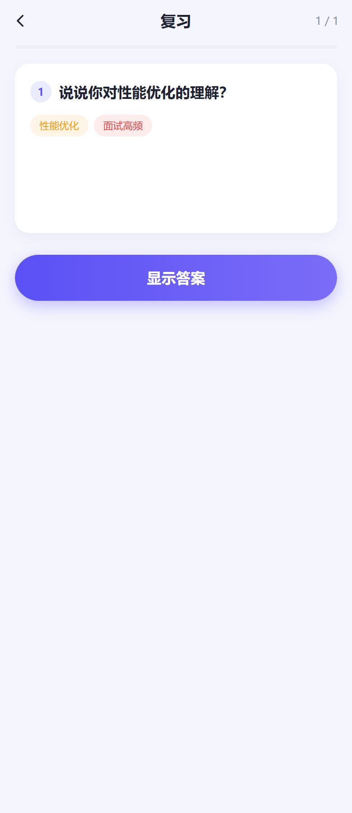<br><sub><b>10</b> 复习会话 · 先答后看</sub></td>
    <td align="center" valign="top">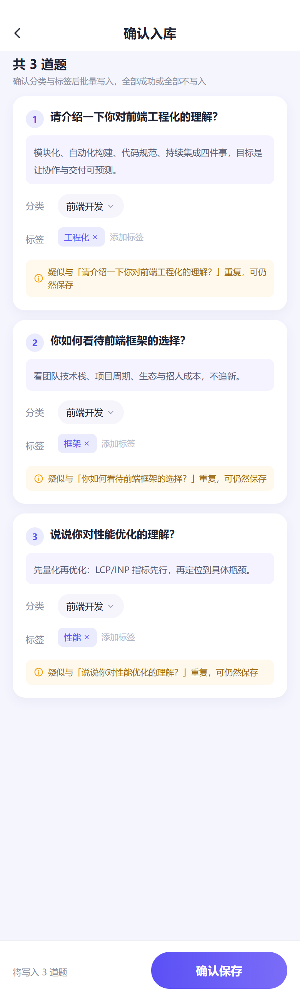<br><sub><b>11</b> 确认入库 · 逐题打标</sub></td>
    <td align="center" valign="top">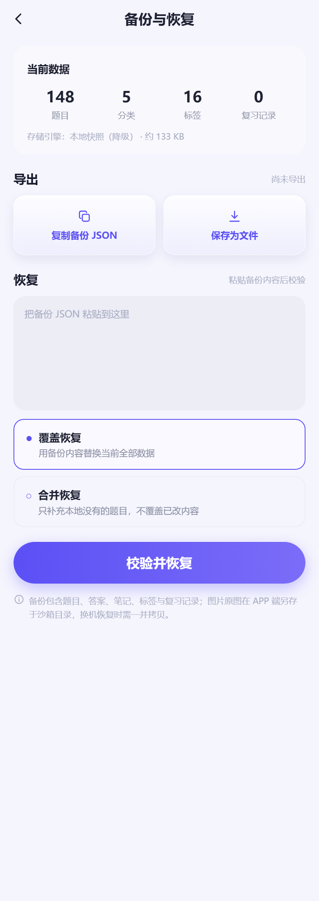<br><sub><b>12</b> 备份恢复 · 导出 / 覆盖 / 合并</sub></td>
  </tr>
  <tr>
    <td align="center" valign="top">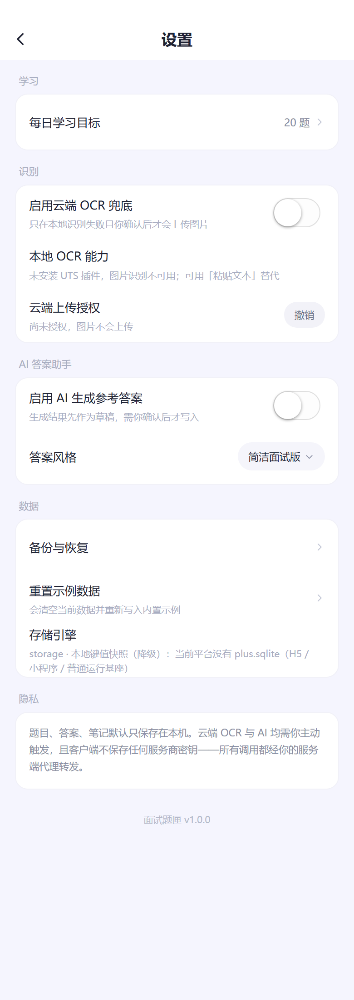<br><sub><b>13</b> 设置 · 引擎与授权状态</sub></td>
  </tr>
</table>

</details>

---

## 一、运行

```bash
npm install
npm run dev:h5          # 浏览器调试（数据走 storage 降级实现）
npm run dev:app         # APP（需自定义基座，见「已知限制」）
npm run dev:mp-weixin   # 微信小程序（无 SQLite / 无本地 OCR）

npm run type-check      # vue-tsc --noEmit，strict 模式
npm run build:h5        # 产物 dist/build/h5
npm run build:mp-weixin # 产物 dist/build/mp-weixin
npm run preview         # 真实渲染截图，产物 preview/screens/*.png（需本机 Chrome）
npm run verify:backup   # 备份三段式端到端验证（导出 → 清空 → 导入）
npm run verify:segment  # 拆题规则回归（两份真实 OCR 原文 + 编号写法 + 负例）

# 部署到子路径时（GitHub Pages 就是这样）要告诉构建产物资源前缀，否则 /assets/* 会 404
UNI_H5_BASE=/interview-box/ npm run build:h5
```

首次启动自动播种示例数据（4 个分类、10 个标签、18 道题），
`更多 → 清空数据` 可从零开始。播种前先判空，不会覆盖你后来的题。

> `npm run preview` 会调本机 Chrome 截图。默认找
> `/c/Program Files/Google/Chrome/Application/chrome.exe`（Git Bash 写法），
> 装在别处就指定一次：`CHROME_BIN="/c/Program Files (x86)/Google/Chrome/Application/chrome.exe" npm run preview`。
> 没装 Chrome 也不影响开发，只是截图脚本会失败。

---

## 二、目录

```
src/
├── pages/            # 13 个页面，按功能分目录
│   ├── home/         # 首页：四入口 + 统计 + 最近学习
│   ├── library/      # 题库：分类总览 / 列表 / 搜索
│   ├── capture/      # 识别、识别结果校对、批量入库
│   ├── question/     # 详情、编辑（含 AI 草稿）
│   ├── review/       # 复习首页、复习计划
│   ├── study/        # 学习会话
│   └── profile/      # 更多、设置、备份恢复
├── components/       # NavBar / TabBar / QuestionCard / AnswerEditor / TagSelector / OcrProgress …
├── stores/           # Pinia：app（启动与统计）、settings（偏好）
├── services/         # 业务编排：ocr、ai、review、backup、question（拆题 + 打标）
├── repositories/     # 表级读写，唯一接触 DatabaseAdapter 的层
├── adapters/         # 平台差异全部关在这里
│   ├── database/     # sqlite / storage 两套实现 + schema + 字段映射
│   ├── ocr/          # local（UTS 插件，仅 APP）+ web（tesseract.js WASM，仅 H5）+ cloud（走代理）
│   ├── file/         # 图片落 `_doc/interview-box/images/`
│   └── network/      # 只连自己的轻量代理
├── uni_modules/
│   └── local-ocr-lite/   # UTS 插件：interface.uts 定契约，app-android 用 ML Kit
├── static/ocr/       # H5 专用：tesseract worker + core + chi_sim 模型（5.5MB，构建后从非 H5 产物剔除）
├── types/            # models / ocr / ai / db
├── utils/            # id、date、text、icons、event
└── styles/           # 设计 token 与公共类
```

---

## 三、数据层

### 3.1 七张表

`categories` · `questions` · `tags` · `question_tags` · `source_assets` ·
`question_sources` · `review_logs`

约定：UUID 主键、毫秒时间戳、`difficulty` 取 1/2/3、
`mastery_status ∈ new | learning | fuzzy | mastered`、软删除用 `deleted_at`。

两张「来源表」是刻意拆开的：

- `source_assets` 存**原始图片 / 原始 OCR 文本**（`raw_text` + 可编辑的 `edited_text`），
  一张图可以支撑多道题，删题不删图；
- `question_sources` 是题目 ↔ 素材的多对多，同时记 OCR 引擎与质量提示。

这样「OCR 原文必须保留」「一图多题」「图片重启后还在」三条要求才有落点，
而不是把图片路径硬塞进 `questions` 一行里。

### 3.2 版本化迁移，不在启动时乱建表

`schema_migrations` 先建，然后只跑**版本号大于已记录值**的迁移，整批包在
`begin / commit / rollback` 里，失败则回滚且保留旧版本号。
新增 v2 只需往 `MIGRATIONS` 追加一项。

### 3.3 一个接口，两套实现

```ts
interface DatabaseAdapter {
  kind: 'sqlite' | 'storage'
  all / first / count / insert / insertMany / update / remove
  transaction / dump / restore / schemaVersion
}
```

- **APP** → `plus.sqlite`（`_doc/interview_box.db`），真正的 SQL 与事务；
- **H5 / 小程序 / APP 打开库失败** → `uni.storage` 全量快照降级。

仓库层只认接口，永不 `if (platform)`。降级不藏着：`dbFallbackInfo()` 把 `engine`
与 `reason` 交给设置页展示（「本地键值快照（降级）：当前平台无 SQLite」）。

> `plus.sqlite` 的 `executeSql` **不支持参数绑定**，所以值全部经 `sqlLit()` 转成字面量
> （单引号翻倍、`undefined`→`NULL`、布尔→0/1）。这是该能力下唯一可行的做法，
> 也是本层最需要小心的地方。

---

## 四、四个关键流程

### 4.1 OCR：本地优先，云端必须你点头

```
拍照/选图 → 复制进 _doc（持久路径）→ 本地引擎识别
                                   ↓ 失败
                         已授权？ → 二次确认 → 云端代理识别
                                   ↓ 都失败
                        可读错误（两个原因都列出）→ 引导粘贴文本/手录
```

- `OCRAdapter` 只有 `isSupported()` + `recognize()`，云与本地同签名，上层不感知差异；
- 授权状态持久化在 `interview_box_ocr_consent`，**拒绝时不会发出任何网络请求**，
  设置页可随时撤销；
- 多图**顺序识别**，`OcrProgress` 逐图显示进度，一张失败不拖垮整批；
- 识别结果页可直接改文字、按编号拆题、合并相邻题，原文留在 `source_assets`。

本地引擎按平台各一套，都不是占位实现：

| 平台 | 实现 | 说明 |
| --- | --- | --- |
| H5 | `tesseract.js` v7（WebAssembly），`adapters/ocr/web.ts` | worker + core + `chi_sim` 模型共 **5.5MB 随包放在 `src/static/ocr/`**，运行期不发任何外部请求；首次识别才动态加载，之后复用同一个 worker |
| APP · Android | UTS 插件 `local-ocr-lite`，ML Kit 中文离线模型 | 模型随 APK 走，完全离线；中英混排同一套模型，`useEffect` / `HTTPS` 这类词不会漏 |
| APP · iOS | **未实现**，`isSupported()` 如实返回 false | 原因见[已知限制](#七已知限制如实列出)第 2 条 |

`src/static/ocr/` 是 H5 专用，但 uni 会把 `src/static` 原样拷进**每个平台**的产物
（小程序主包只有 2MB），所以 `build:*` 后面统一跟一个 `scripts/trim-static.mjs`，
把非 H5 产物里的 `static/ocr` 删掉 —— 构建日志里能看到「清理 mp-weixin/static/ocr（5.5MB）」。

#### UTS 插件怎么调：`import`，不是 `requireNativePlugin`

这是本次踩得最贵的一个坑。最早的 `adapters/ocr/local.ts` 用
`uni.requireNativePlugin('local-ocr-lite')` 取插件，**永远拿到 undefined**，
表现就是 `isSupported()` 恒 false、页面一直提示「识别暂不可用」——
看着像插件没装上，其实是取法错了。

官方给的区别很明确：原生语言插件（`nativeplugins/`，Java/OC 写的）才用 `uni.requireNativePlugin()`；
**UTS 插件在编译期就翻成原生代码，JS 侧就是普通 `import`，而且参与摇树**。所以只有

```ts
// #ifdef APP-PLUS
import * as UtsOcr from '@/uni_modules/local-ocr-lite'
// #endif
```

才会让编译器把插件编进基座、并生成 JS 桥（产物里能看到
`initUTSProxyFunction(... name:"isSupportedByJs")` 对应原生侧的 `isSupportedByJs()`）。
整段 import 必须包在 `#ifdef APP-PLUS` 里：`utssdk/` 是原生源码，
H5 / 小程序产物里不该出现（小程序也编不过）。

配套的两件事：

- 引了 UTS 插件后，`uni build -p app` 会要求 `@dcloudio/uni-uts-v1`，已在 `devDependencies` 里；
- `utssdk/interface.uts` 是 UTS 语法，`vue-tsc` 不认，所以 `src/env.d.ts` 里手写了一份
  `declare module '@/uni_modules/local-ocr-lite'`，**改接口时两边要一起改**。

#### 拆题：一次「识别不准」的误判

用户反馈「准确率不行，识别处理不对」，附了一张题目列表截图和一张结果截图——13 道题只剩两条：
`【第 1 张】` 和 `49 澡"咱会廿`。看起来像 OCR 崩了。

实际量下来不是。先把那张图在同一套 tesseract 配置下跑一遍，用 13 道题的**题面相似度**打分：

| 配置 | 题面均分 | 拆出题数 |
| --- | --- | --- |
| `chi_sim` / 原图 / psm6（最终采用） | **0.996** | 13/13 |
| `chi_sim+eng` / 原图 / psm6 | 0.924 | 12/13 |
| `chi_sim+eng` / 灰度+对比度拉伸 / psm6 | 0.987 | 12/13 |
| `chi_sim+eng` / 2 倍放大 / psm6 | 0.852 | 11/13 |

OCR 本身几乎是对的。真正的问题在 `services/question/segmenter.ts`：

1. 它只认 `1.` `1、` `(1)` 这类**文字题号**，而这张截图里题号是**界面上的圆形图标**，
   OCR 拿不到数字——13 行一条都没匹配上，整段被并成 1 块；
2. 唯一的 `01:49` 状态栏时间反而命中了 `\d{1,3}:` 那条编号规则，成了「第 1 题」；
3. 剩下的字被塞进第 2 块，就是那句 `49 澡"咱会廿`。

所以补了第二条切分策略：**问句式**。整段是一行一条的清单、题号又是图标时，
「带问号的短行」才是可靠边界。两条策略都跑，取拆得多的那条；编号式仍然优先于一切。

`isQuestionLine()` 只做两件事——行内有问号就算题面（不锚定行尾，因为 OCR 常在问号后
拖一个「简单/中等」的残字）；界面把题面截断成「…」导致问号没了，则靠「省略号 + 行尾难度标签」认。
上限定 60 字是为了排除「正文里恰好有问号」的段落。触发门槛是**问句行 ≥ 3 且过半**，
避免把散文拆散。

拆出来之后还有一层：题号图标被 OCR 认成的残渣得抹掉。这个只能靠实测反推，
所以 `scripts/fixtures/` 里放的是**两份真实输出**，同一张图两条链路各跑一遍：

| 夹具 | 链路 | 图标被认成 |
| --- | --- | --- |
| `ocr-list-screenshot.txt` | Node（tesseract.js 直接读 Buffer） | `《O` `《9` `《约` `《OA2A` |
| `ocr-list-browser.txt` | 浏览器（同一套 wasm，走 canvas） | `《O` `《DRAG` `人 ` `人9 ` |

清理规则踩了两个坑，都在代码注释里写死了：

- **「图标 + 一个汉字」那支必须要求紧跟空格**。先写成「图标 → 可选数字 → 可选汉字」，
  `《2 在 RAG…` 里的「在」就被吞了，题面变成「RAG 应用中…」；
- **「图标 + 大写字母」那支要加 `(?![a-z])`**。否则 `《Python 编程…` 这种书名列会被削成「ython」，
  而 `《DRAG` 后面跟的是大写 `R`，照削不误——正好把 `D` 去掉。

这两份夹具 + 6 种编号写法 + 4 条负例 = `npm run verify:segment` 的 48 项断言，
已接进 CI。规则是纯字符串处理，改一条正则就可能悄悄改掉别处，不钉住不行。

### 4.2 AI：只产草稿，绝不覆盖已有答案

```
generate() → AiAnswerDraft（内存草稿，不落库）
   ↓ 用户可改
acceptDraft({ editedText, overwrite })   ← 唯一写 reference_answer 的入口
```

- 答案强制五段式（结论 / 原理 / 落地 / 取舍 / 追问）；
- 已有参考答案时 `overwrite: false` 会被直接拒绝，前端还要再确认一次；
- 写入后 `answer_origin` 标记 `ai` / `ai_edited`，详情页能看出这段答案的来历。

### 4.3 复习：日志先于状态

`applyReview()` 先写 `review_logs`，再更新题目状态与 `next_review_at`。
顺序反了就会出现「状态变了但没记录」，连续天数与会话统计失真。
排期 1/3/7 → 14/30 天，模糊回答回退，已掌握只做长间隔回顾。

### 4.4 备份：带校验的可恢复包

导出 `{ schemaVersion, exportedAt, counts, tables, checksum }`；恢复前先 `validate()`
比对表结构与条数，再按 `replace` / `merge` 写库，`replace` 在事务里先清空。
图片路径原样带上，恢复后仍可打开。

---

## 五、平台差异（能力边界，不是 bug）

| | APP（Android/iOS） | H5 | 微信小程序 |
| --- | --- | --- | --- |
| 数据库 | `plus.sqlite` | storage 快照 | storage 快照 |
| 本地 OCR | Android：ML Kit 中文离线模型（已本地编译通过，需自定义基座）；iOS：未实现 | tesseract.js WASM，**开箱可用** | 不支持 |
| 图片持久化 | 复制进 `_doc` | 临时路径 | 临时路径 |
| 云端 OCR / AI | 走自建代理 | 同 | 同 |

微信小程序产物里 `sqlite.ts` 已被条件编译**整体剔除**（只剩提示文案字符串），
不会因为引用 `plus` 而报错；OCR 走同一套接口，`isSupported()` 返回 false，
`capabilities()` 把「为什么不可用」原样透给页面，而不是一句笼统的「暂不支持」。

---

## 六、验证记录

下表前六项在 CI 里自动跑（`.github/workflows/ci.yml`，push / PR 触发，Node 22）；
带 ※ 的四项是本机手工验证 —— UTS 原生编译需要 HBuilderX + Android SDK，CI 上装不了，如实标注。

| 项 | 结果 |
| --- | --- |
| `npm run type-check` | **0 error**（strict，覆盖 13 个页面与全部 .vue） |
| `npm run build:h5` | 成功，按路由分包 |
| `npm run build:mp-weixin` | 成功，`plus.sqlite` 未进包 |
| `npm run verify:backup` | **35 项全通过**（导出 → 清空 → 覆盖恢复 → 合并恢复，含 5 条负例） |
| `npm run verify:segment` | **48 项全通过**（两份真实 OCR 输出逐条比对 + 6 种编号写法 + 4 条负例） |
| 拆题准确率（真实截图）※ | 13/13 条题面与截图逐字对上，题面相似度 **0.996**，详见 4.1 |
| 产物密钥扫描 | `dist/` 内无 `sk-` / `AKID` / `gh?_` / 私钥块，命中即 fail（跳过 `static/ocr` 第三方 wasm 内核与二进制 —— 那几 MB 随机字节必然误伤，规则本身没放宽，塞个假 `AKID` 进去照样能拦下） |
| GitHub Pages | verify 全绿后自动部署到 <https://zhangfengyao01.github.io/interview-box/>（PR 只验不发布） |
| 启动兜底（H5）※ | 四种情形实测：正常不出现 / 资源 404 立即报出失败 URL / 脚本空转 8 秒超时报 / 慢加载跨过超时后自动撤回 |
| UTS 插件本地编译 ※ | `cli compile app-android` **编译成功**，ML Kit 两包依赖经 Gradle 拉通，详见 6.4 |
| APP 端构建 ※ | `uni build -p app` 成功，产物里已生成 `utssdk/app-android/src/index.kt`（133 行）与 iOS 的 `index.swift` |
| H5 / 小程序无原生残留 ※ | 两个产物内都搜不到 `local-ocr-lite`；H5 侧 `static/ocr/` 三件套齐全 |
| 视觉对照 | `npm run preview` 真实渲染 **13 屏**（设计稿 8 屏 + 5 个二级页），逐屏比对，全部图见上面的[界面一览](#界面一览) |

### 6.0 备份恢复验的是什么

`npm run verify:backup` 跑的不是重写一遍的逻辑，而是 `services/backup` + `adapters/database`
的真代码（用 esbuild 把 TS 打成临时 ESM，垫一个内存版 `uni` storage 再执行）：

1. 播种 → 埋「探针笔记 / 探针答案 / 一条复习记录」→ 导出；
2. **负例**：改条数、抬高 schema 版本、换 app 名、半截 JSON、缺题目数组 —— 五种坏文件必须被挡；
3. 清空（题目/分类归零）；
4. **覆盖恢复**：七张表逐表逐行与导出前完全一致，笔记/答案/复习记录都在；
5. **合并恢复**：库里已有 → 新增 0、跳过 N，且用户改过的笔记**没被覆盖**；
6. 删掉一题再合并 → 能补回，计数正确。

跑的是 storage 引擎（H5/小程序同款降级实现）；`plus.sqlite` 需要真机，**没覆盖**，脚本会打印引擎名。

### 6.1 UI 还原的做法

设计稿是一张 1254×1254 的 JPG 拼图，**肉眼估色不可靠**，所以颜色是算出来的：
把每个屏的手机区域切出来，对饱和像素做 `quantize()` 聚类再取中位数，得到

| token | 值 | 用途 |
| --- | --- | --- |
| `--primary` | `#5B50F5` | 主色（早先误判为 `#6C5CE7`，偏红） |
| `--primary-deep` | `#4A3FE0` | 按压 / 深色描边 |
| `--primary-soft` | `#EAEBFD` | 浅紫底（chip、按钮底） |
| `--bg-page` | `#F5F5FE` | **页面底不是纯白**，是带紫的浅灰 |
| `--text` | `#171A2C` | 正文近黑 |

结构差异不是靠改色能解决的，逐项重建：我的题库改成「一个白容器 + 四行 + 容器内主按钮」、
首页入口图标换成实心（图标下面不再垫方块）、TabBar 选中态用实心图标 + 短下划线、
banner 加「扫描框背板 + 倾斜纸张 + 手绘标语弧线」、复习页圆环用 conic-gradient 蓝紫渐变、
头像用纯 CSS 画（不引位图）。

### 6.2 截图为什么必须走 iframe

headless Chrome 有约 **504px 的最小视口**，直接 `--window-size=390,844` 会按 504 渲染再裁切，
右侧内容直接丢失（表现为「相册识别」卡片被切）。所以 `preview/live_shot.html` 用一个固定
`390px` 的 iframe 承载页面、外层窗口开成 390×N，再按 2 倍图截图。
详情页/识别结果页依赖运行时数据（演示库每次冷启动都会重新播种、id 是随机 uuid），
所以探针页要么先启动应用读出 id 再 `location.hash` 跳转，要么先把草稿写进 storage 再跳。

### 6.3 启动兜底为什么写在 index.html

H5 白屏是没法调试的：资源 404 时控制台之外什么都没有，用户只会以为"这站打不开"。
所以兜底放在**入口 HTML 里、入口脚本之前**，不依赖任何构建产物能不能加载：

1. **资源级错误**：`window.addEventListener('error', fn, true)` 用捕获阶段才接得到
   `script` / `link` 的加载失败（这类事件不冒泡），能直接报出是哪个 URL 没了；
2. **静默失败**：8 秒还没长出内容就报超时（`MutationObserver` 盯着 `#app`）；
3. 一旦 `#app` 真的长出内容，立刻撤回兜底 —— 慢网络下"先报错、后加载出来"也算正常；
4. 文案里明说**刷新不会丢数据**，因为题库存在本机 localStorage，绝不能在兜底里提供"清缓存"这种操作。

它只覆盖 H5；小程序端由微信自己的错误页接管，APP 端走 `plus` 的启动流程。

四种情形都拿真浏览器跑过（`--dump-dom` 看最终 DOM 算不算法）：

| 情形 | 做法 | 结果 |
| --- | --- | --- |
| 正常 | 原样加载 | 兜底不可见，`#app` 正常渲染 |
| 入口 404 | 删掉 `assets/index-*.js` | 立刻亮出，文案带上**具体失败的 URL** |
| 脚本空转 | 把入口 js 清成 0 字节 | 8 秒后亮出，文案是「8 秒内页面没有渲染出内容」 |
| 慢加载 | 把入口改成 10 秒后再挂 | 第 8 秒先亮出、第 10 秒加载成功后**自动撤回** |

### 6.4 UTS 插件怎么验证的（以及踩的三个坑）

HBuilderX 自带一个 CLI，可以不打开 IDE 就编单个 uni_modules：

```bash
# 在 HBuilderX 安装目录下执行
./cli.exe compile app-android \
  --project "C:\Users\27538\Desktop\微信小程序\interview-box" \
  --uni_module src/uni_modules/local-ocr-lite
```

带三方 Maven 依赖的插件（我们是 `com.google.mlkit:text-recognition-chinese`）**必须先配运行配置**，
否则编译器没有 classpath，只会甩一句 `找不到名称"google"` —— 那是 UTS 的「已知问题 error18」，
极易被误判成代码写错。三个配置项用 CLI 写进 `%APPDATA%\HBuilder X\user\settings.json`：

```bash
./cli.exe config set --key uts-development-android.sdkDir     --value "C:\Users\27538\AppData\Local\Android\sdk"
./cli.exe config set --key uts-development-android.javaHome   --value "C:\Program Files\Android\Android Studio\jbr"
./cli.exe config set --key uts-development-android.gradleHome --value "...\gradle-8.9\bin\gradle.bat"
```

坑逐个说清楚：

1. **`找不到名称"google"`（error18）不是语法错**，是依赖没解析。要装 HBuilderX 的
   「uts Android 运行扩展」，并配齐 SDK / JDK / Gradle。Gradle 必须 **7.5 ≤ x < 9**
   （内置 Gradle 插件版本是 AGP 8.2.2），JDK 要 17，SDK 的 `build-tools` ≥ 30、`platforms` ≥ android-30。
2. **`参数类型不匹配：实际类型为 'Number'，预期 'Int'`（error17）**：UTS 的 `number` 在 Kotlin 侧是
   `kotlin.Number` 抽象类型，`List.get()` 要 `Int`，所以 `textBlocks.get(i)` 必须写成
   **`textBlocks.get(i.toInt())`**。同理，调系统/三方 SDK 且对方签名写死 `Int` 的地方都要转。
3. **依赖下载会走 `maven.aliyun.com` 镜像**（插件模板里写死的 public + google 仓），
   首次约 3 分钟；之后命中缓存，19 秒编完。

编译通过的判据是日志末行 `项目 interview-box（模块 local-ocr-lite）编译成功。`，
产物落在 `unpackage/uts/...` 与 APP 构建目录的 `uni_modules/local-ocr-lite/utssdk/app-android/src/index.kt`。

---

## 七、已知限制（如实列出）

1. **真机未验证**：`plus.sqlite` 与 UTS OCR 需要 Android/iOS 打包环境。本仓库完成的是
   类型检查 + H5 / 小程序编译 + **UTS 插件本地编译（Kotlin 编译通过）** + H5 运行逻辑，
   **没有在真机上跑过**，所以「ML Kit 在真机上识别得准不准」这件事这里没有结论。
   `plus.sqlite` 与真机 OCR 都需要先打自定义调试基座（普通标准基座里没有插件原生代码）。
2. **iOS 端 OCR 未实现**：`utssdk/app-ios/index.uts` 明确返回「不支持」。
   UTS 的 iOS 侧只能在 macOS + Xcode 里编译验证，本机是 Windows ——
   写个没编译过的 Vision 版本比没有更糟（用户会以为识别失败是图片问题）。
   接的时候把那个文件换成 `VNRecognizeTextRequest`（`recognitionLanguages = ["zh-Hans","en-US"]`），
   接口不用动。
3. **云端代理未提供**：只有 `adapters/network` 与设置页的端点配置，
   服务端（腾讯云 OCR / 大模型转发）需自行实现，约定见 `services/ocr`、`services/ai`。
4. **插画是 CSS/图标复现**：设计稿的手绘插画（banner 纸张、日历、头像）用渐变块 + 图标重画，
   不是位图原样抠图。
5. **示例数据是 18 题**：设计稿上的 128 题 / 12 今日新增 / 92% 掌握率是示意值，
   首页数字全部来自真实统计，不写死。演示数据里今天还没学，所以复习页圆环是 0/20。
6. **无账号与多端同步**：PRD 明确本地优先，同步不在本期范围。
7. **在线预览是 H5 版**：走 storage 快照，图片是临时路径（刷新后可能失效）。
   但它**有本地 OCR**（tesseract.js WASM），不需要联网、不需要代理，可以直接传张试题截图试。
   它用来「点开就能看界面」，不是真机能力的证明 —— 真机差异见[第五节](#五平台差异能力边界不是-bug)。
   另外换设备/换浏览器就是另一份数据，因为数据只存在你自己的 localStorage 里。
8. **H5 的 OCR 是「够用」不是「最优」**：只带 `chi_sim` 一个模型（5.5MB），
   纯英文/代码符号会掉字，大段英文建议用粘贴文本。实测过加 `eng` 一起跑，
   反而是变差的（题面均分 0.924 vs 0.996）—— 中英混合时 `eng` 会抢掉部分汉字的判定。
   另外截图里的**题号图标**（界面上的圆形数字）本就不是文字，OCR 认成 `《O` / `人` / `D` 这类杂字，
   拆题时会尽量抹掉，但抹不干净时可能残留一个字符（例如 `《Python` 这种书名列，为了不误伤会选择保留）。
   这是刻意取舍：宁可留一个杂字，也不吃正文。

---

## 八、开发工具

- `preview/screens.sh`（`npm run preview`）：起临时静态服务 → 逐屏真实渲染截图 → 关服务。
  产物在 `preview/screens/`，2 倍图：`01-08` 是设计稿的 8 屏，`09-13` 是设计稿没画、
  但内部要验收的二级页（编辑题目 / 复习会话 / 批量入库 / 备份恢复 / 设置）。
- `preview/shoot.sh`：单屏截图，`bash preview/shoot.sh <名字> <路由> [高度] [query]`。
- `preview/live_shot.html`：390px iframe 承载页；路由里写 `{{id}}` 时，先启动应用读出题目 id
  再替换进去跳转（演示库每次冷启动都会重新播种，id 是随机 uuid）。
- `preview/_seed.html`：把一份草稿写进 storage 后再跳过去，用于验收识别结果页（`kind=ocr`）
  和批量入库页（`kind=batch`）—— 这两页没有 URL 入参，只能靠 storage 交接。
- `preview/_measure.html`：在 iframe 里跑 `getBoundingClientRect` / `elementFromPoint`，
  定位「文字被谁盖住」这类只在实际渲染里才暴露的问题。
- `scripts/verify-backup.mjs`（`npm run verify:backup`）：备份三段式的端到端验证，见 6.0。
- `scripts/verify-segment.mjs`（`npm run verify:segment`）：拆题规则的回归验证，见 4.1。
  夹具 `scripts/fixtures/ocr-list-*.txt` 是**真实**识别原文，同图两条链路各一份，不是手写的。
  `npm run verify:segment` 与 `verify:backup` 都已接进 CI。
- `scripts/port-page.js`：迁移期用于把旧页面「原样保留 template/style、只换 script」，
  保证换技术栈不改像素。

---

## 九、许可证

[MIT](LICENSE) © 2026 张凤垚。随便用、随便改，保留版权声明即可。

界面按给定设计稿复刻，设计稿版权归原作者；仓库内不含任何设计源文件。
项目不内置任何 OCR / 大模型的密钥，也没有账号体系，**没有收集任何用户数据**。
